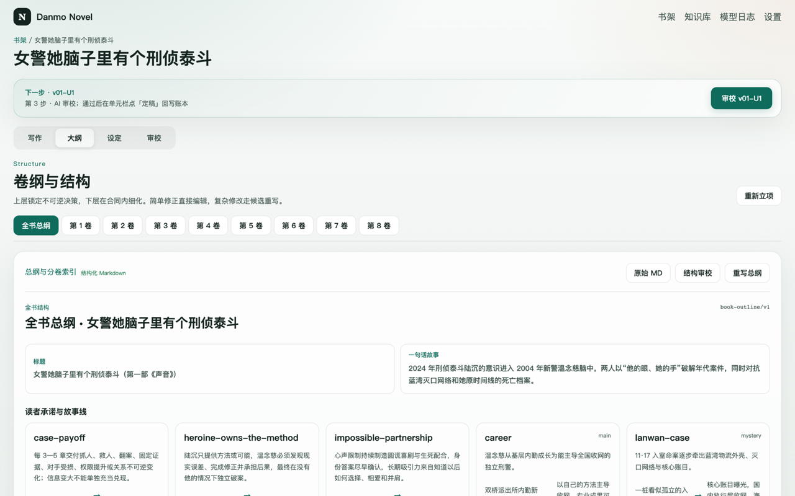
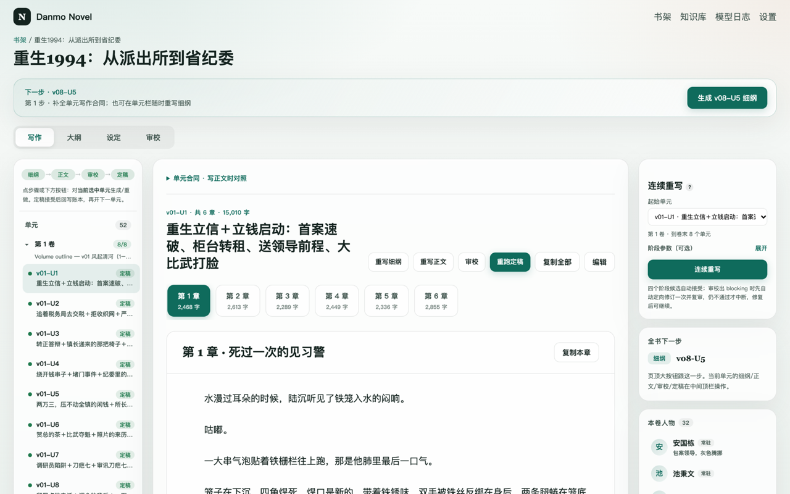
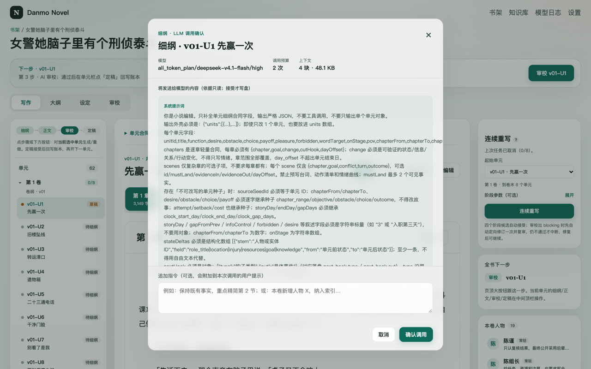
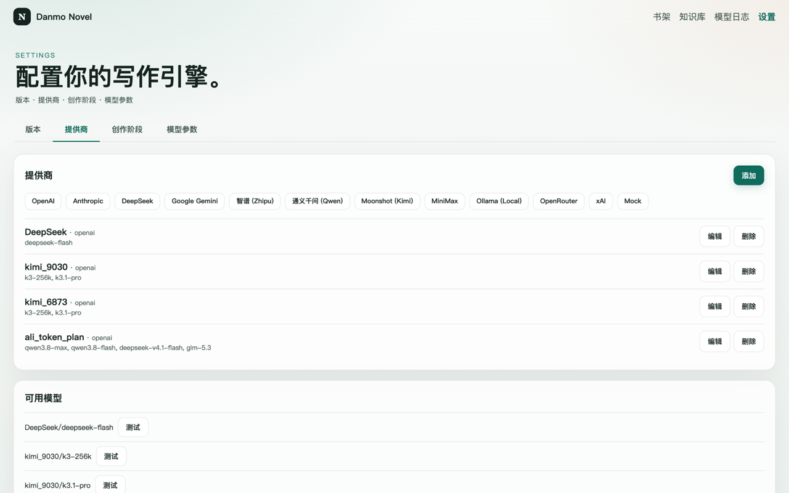

# Danmo Novel

**受控 AI 长篇小说生产工作台。** 不是聊天式续写工具，而是一条有预算、有校验、有人工闸门的流水线：
AI 只产出**候选**，你确认后才落盘成为正文或正史。


## 为什么不是「让 AI 一直写」

长篇的失败通常不发生在句子层面，而发生在三件事上：**失控的上下文、无法复验的输出、被静默覆盖的设定**。
Danmo Novel 针对这三点做了硬约束：

| 问题 | 做法 |
| --- | --- |
| 上下文失控 | 每次调用的数据组装是固定 Go 函数；按任务精确挑选片段，作者指令只作补充数据 |
| 输出无法复验 | 每个任务绑定结构化输出协议 + 可执行校验；不合规最多一次定向修复，没有无界 Agent Loop |
| 设定被静默覆盖 | 生成永不写盘；只有 **接受候选** 才写正文 / canon / 账本，并留 diff 供复核 |

## 核心能力

### 结构化大纲：总纲 → 卷纲 → 单元细纲，层层收口

大纲是可校验的结构化 Markdown，不是一段散文。上层锁定不可逆决策，下层只能细化，不能换故事；
章范围、继承字段、揭示边界、身份变更全部做引用校验。



### 单元闭环：细纲 → 正文 → 审校 → 定稿

以「单元」（3–8 章一次矛盾从起到收）为最小生产单位。逐单元推进，下一步永远明确；
定稿接受后自动回写连续性账本，下一单元才能读到最新事实。



### 调用前先看清代价：模型、预算、知识、保留路径

每次生成前弹出确认：这次调用哪个模型、给多少输出预算、注入哪些参考知识、哪些文件保持不动。



### 多提供商，按创作阶段分别指派模型

立项 / 细纲 / 正文 / 审校 / 局部编辑各自绑定模型；协议方言独立适配（OpenAI、Responses、Anthropic 及 DeepSeek / Qwen / Kimi / GLM 等）。



### 每次调用都可审计

token 用量、耗时、缓存命中、失败原因逐条留档。重试把修复指令追加在 payload 末尾，
前缀缓存仍然命中——这是「重试几乎免费」的证据，也是缓存被破坏时的告警。


### 正史分层：设定、身份、关系各有其位

作者底牌、公开揭示计划、人物三锚点、职务身份时间线分开管理；正文与审校永远看不到作者底牌。
身份转换只能在单元边界发生，避免「人物突然变成另一个人」。


## 工作流


单元状态流：`proposed → accepted → drafted → reviewed`。候选不等于已接受事实。

## 快速开始

```bash
make dev          # API :7804 · UI :5804
make dev-desktop  # 后端 + Tauri 桌面壳
```

首次使用在「设置 → 模型」添加提供商、启用模型，然后为各创作阶段指派模型。

## 桌面与发布

```bash
make pack-macos-desktop RELEASE_VERSION=0.1.0
# 或 pack-linux-desktop / pack-windows-desktop
```

打 `v*` tag 触发 GitHub Actions，产出三平台安装包与 Tauri 自升级清单。详见 [docs/desktop-release.md](docs/desktop-release.md)。

## 数据与目录

| 位置 | 内容 |
| --- | --- |
| `~/.danmo-novel/novel.db` | 提供商配置、任务、候选 |
| `~/Library/Mobile Documents/iCloud~com~danmo~novel/Documents/library/novel/<book-id>/` | 书籍本体（Markdown / YAML，macOS 与 iOS 共用） |
| `~/Library/Mobile Documents/iCloud~com~danmo~novel/Documents/model-settings.json` | 模型设置共享快照（不含 API Key） |
| `~/.danmo-novel/library/novel/<book-id>/` | 非 macOS 系统的书籍本体，以及首次启用 iCloud 前留下的存量 |

按系统区分，不按宿主区分：macOS 一律读写上面的 iCloud 容器，Windows/Linux 用
本机目录。路径只在 Go 内核解析一次，因此打包后的 App、`make dev`、`make dev-desktop`
与 `go run` 在同一台 Mac 上读的是同一个书库与 `model-settings.json`。
`novel.db`（任务、候选、审校历史）始终留在本机，避免两台设备同时写一个 SQLite 文件；
API Key 不同步，每台设备各填一次。

设置 → 书籍目录 可以把书库改到任意目录（`PUT /api/settings/library-root`）。只有
用户的选择会被保存（`customLibraryRoot`），生效路径每次启动重新计算，所以 macOS
在 iCloud 目录出现后会自动切过去。确认更改会把当前目录下所有书籍与知识文档
**移动**到新目录，然后重建注册表；目标目录已有同名书籍时拒绝操作。留空即恢复
系统默认目录。启用 iCloud 后的第一次启动也走同一套移动逻辑，把
`~/.danmo-novel/library` 里已有的书一次性搬进容器。桌面版没有 iCloud
entitlement，只有在 iCloud 已把容器目录生成到本机后才使用它（通常先在 iPhone 上
打开一次 App），否则继续用本机书库。详见
[docs/native-mobile.md](docs/native-mobile.md#icloud-sharing-ios--macos)。

书籍是磁盘上的 Markdown + YAML，SQLite 只存配置与运行记录：

```text
<book-id>/
├── book-bible.md           作者意图与读者承诺
├── novel-state.yaml        阶段、游标、门禁
├── canon/                  世界、金手指、风格、写作规则、揭示计划、底牌
│   ├── cast/*.md           人物卡（三锚点 / 知识边界 / 关系表）
│   ├── identity-timeline.yaml  职务身份时间线
│   └── reveal-schedule.md  公开信息释放节奏
├── outline/
│   ├── book_outline.md     总纲（分卷 / 故事线 / 转折）
│   ├── volumes/vNN.md      卷纲（节拍 / 单元索引）
│   └── units/vNN-U#.yaml   单元合同（目标 / 阻碍 / 选择 / 代价 / 状态迁移）
├── units/vNN-U#.md         正文
└── continuity/             账本、摘要、提交记录
```

## 技术栈

Go（后端与流水线）· Vue 3 + Vite（桌面前端）· SQLite（配置与运行记录）· Tauri（桌面壳）· SwiftUI / Compose（原生手机端）

```text
core/
├── adapter/http/      REST 入口
├── adapter/llm/       LLM 适配与协议方言
├── adapter/mcp/       MCP 工具面
├── service/books/     书籍加载、校验、接受写入
├── service/context/   上下文组装与预算
├── service/pipeline/  任务定义、输出协议、校验
├── service/runs/      运行与候选生命周期
└── service/gates/     本地硬门
```

## 文档

- [实体模型与职责](docs/novel-entity-model.md)
- [创作与重写流程、模型输入输出](docs/novel-production-workflows.md)
- [标准书籍模板与迁移占位符](docs/novel-book-templates.md)
- [桌面打包与自动更新](docs/desktop-release.md)
- [原生移动端与 iPhone Duo 规范](docs/native-mobile.md)

## 开发

```bash
make test    # go test ./...
make build   # 前端构建 + 服务端二进制
```

## 设计取向

- **没有 Agent Loop。** 任务是固定合同：固定的上下文、固定的输出协议、固定的调用预算。
- **候选优先。** 生成只生产候选；接受是唯一的写盘路径。
- **失败要显形。** 校验失败、结构冲突、身份缺失都以可行动的报错暴露，不静默降级。
- **不隐藏成本。** 每次调用前看得到模型、预算与注入的知识。
